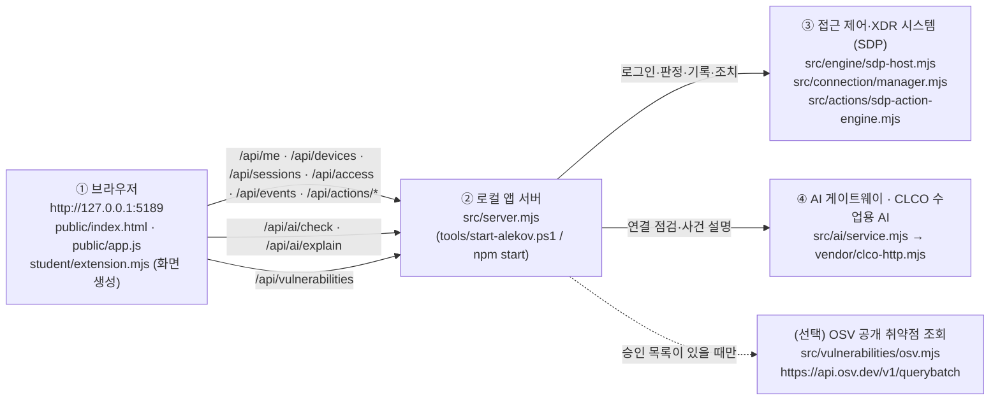

# 학생 설명서 · 보안 Agent 「케셰브」 (13~21단계)

이 문서는 학생이 새로 만든 실행 설명서와 구성도입니다. 제공 문서(`README.md`, `docs/` 의 다른 파일)는 고치지 않았습니다.

> 열쇠·비밀번호·토큰 같은 비밀 값은 이 문서와 코드, 커밋 어디에도 넣지 않습니다. 비밀 값은 제출에서 빠지는 `.env` 같은 파일에만 둡니다.

---

## 0. 목적·기능·지원 환경

**목적**: 회사 직원이 자기 로그인 상태, 업무 앱 접속 판정, 최근 접속 기록과 보안 경보, AI 사건 설명, 조치 상태, 사용 라이브러리 취약점 정보를 한 화면에서 보는 보안 Agent 입니다.

**기능(학생 구현)**: 로그인·기기·세션 상태(13) · 업무 앱 접속 판정(14) · 보안 기록과 근거(15) · 상태 요약(16) · 앱 안 AI 연결 점검(17) · 근거가 있는 AI 사건 설명(18) · 조치 상태 표시(19) · 라이브러리와 취약점 정보 대조(20).

**지원 환경과 버전**

| 항목 | 값 | 근거 |
|---|---|---|
| 운영체제 | Windows + PowerShell | `tools/start-alekov.ps1` |
| Node.js (수업·검사 기준) | 24.19.0 | `package.json` 의 `engines.node` |
| Node.js (실행 도구 허용 범위) | 22~24 (24.19.0 이 아니면 `참고: 지금 Node.js 는 vXX 입니다. 수업 기준은 v24.19.0 입니다.` 안내 후 실행) | `tools/start-alekov.ps1` 의 버전 검사, `docs/CONNECTION_TROUBLESHOOT.md` |
| 외부 npm 의존성 | 없음 (`npm install` 필요 없음) | `package.json` 에 `dependencies` 없음 |
| 시작 틀 버전 | 0.2.14 | `package.json` 의 `version` |
| 앱 주소 | http://127.0.0.1:5189 (이 PC 안에서만) | `src/server.mjs` 가 `127.0.0.1` 에서 대기 |
| 실행 도구가 막는 환경 | Node.js 21 이하 또는 25 이상 (`지금 Node.js 는 vXX 입니다. 앱은 Node.js 22~24 에서 실행합니다.` 후 중단) | `tools/start-alekov.ps1` |
| 확인하지 않은 환경 | macOS·Linux 실행, 다른 PC에서 접속, Node.js 22·23 에서의 실제 실행 (학생은 24.19.0 에서만 작업) | 미확인 |

---

## 1. 폴더 구조

```
kesheb-defense\                  ← Git 최상위 폴더
└─ on-client\                    ← PowerShell 을 여는 위치 (모든 명령은 여기서)
   ├─ package.json               ← npm start / demo / check 정의
   ├─ .env.example               ← 비밀 없는 설정 견본
   ├─ public\                    ← 제공 화면 (index.html, app.js …)
   ├─ src\                       ← 제공 앱 서버 (server.mjs, engine\, ai\, actions\, vulnerabilities\ …)
   ├─ student\
   │  ├─ extension.mjs           ← 학생 구현 파일 (13~20단계)
   │  └─ engine-adapter.mjs      ← 학생 영역 (이번 과정에서 고치지 않음)
   ├─ tools\start-alekov.ps1     ← 제공 실행 도구
   ├─ vendor\clco-http.mjs       ← 제공 CLCO 수업용 AI 연결 모듈
   └─ docs\STUDENT_GUIDE.md      ← 이 문서
```

---

## 2. 설치·실행 순서

**PowerShell 여는 위치**: 파일 탐색기에서 `on-client` 폴더를 열고 주소 표시줄에 `powershell` 을 입력해 Enter → 그 폴더에서 새 PowerShell 창이 열립니다.

```powershell
# 1) 저장소 받기 (이미 받은 폴더가 있으면 건너뜀)
git clone https://github.com/sby1234-ai/kesheb-defense.git
cd kesheb-defense\on-client

# 2) Node.js 버전 확인 → 기준 v24.19.0 (실행 도구는 22~24 허용)
node --version

# 3) 학생 코드 문법 확인 (아무 출력 없이 끝나면 정상)
node --check student/extension.mjs

# 4) 앱 켜기
powershell -NoProfile -ExecutionPolicy Bypass -File .\tools\start-alekov.ps1
```

**정상 시작 신호** (4번 실행 뒤 창에 나오는 문구, `tools/start-alekov.ps1` 원문):

```
케셰브가 켜졌습니다. 브라우저에서 http://127.0.0.1:5189/ 을 여세요.
서버가 응답한 것만 확인했습니다. AI 연결 상태는 화면에서 따로 확인해 주세요.
끄려면 이 창에서 Ctrl+C 를 누르세요.
```

5) PC 브라우저에서 **http://127.0.0.1:5189** 를 엽니다. 이 신호는 앱 서버가 응답했다는 뜻일 뿐, AI 연결이나 회사 시스템 연결 성공이 아닙니다.

| 하고 싶은 것 | 명령 | 비고 |
|---|---|---|
| 앱 켜기(다른 방법) | `npm.cmd start` | `node src/server.mjs` 와 같습니다. 창에 `케셰브 연결 확인: http://127.0.0.1:5189` 가 나옵니다. PowerShell 이 `npm` 스크립트를 막으면 `npm.cmd` 로 씁니다. |
| 예제 자료로 화면만 보기 | `npm.cmd run demo` | `node src/server.mjs --demo`. 예제 자료이며 실제 연결이나 성취가 아닙니다. |
| 문법만 확인 | `npm.cmd run check` | `node --check student/extension.mjs` 와 같습니다. |
| 끄기 | 앱을 켠 창에서 `Ctrl+C` | 브라우저 주소가 더 열리지 않으면 꺼진 것입니다. |
| 다시 켜기 | 같은 `on-client` 폴더에서 4) 명령을 다시 실행 | 브라우저를 새로고침합니다. |
| 포트 5189 충돌 | 4) 명령 끝에 ` -Port 5190` | 브라우저 주소도 `http://127.0.0.1:5190` 으로 엽니다. |

---

## 3. 구성도

### 3-1. Mermaid



### 3-2. 같은 내용을 글로

```
① 브라우저 (http://127.0.0.1:5189)
   public/index.html, public/app.js  ──(입력 전달)──▶  student/extension.mjs (DOM 생성만)
        │  HTTP /api/...  (같은 PC, 127.0.0.1)
        ▼
② 로컬 앱 서버  src/server.mjs
        ├──▶ ③ 접근 제어·XDR 시스템 (SDP)   src/engine/sdp-host.mjs, src/connection/manager.mjs
        ├──▶ ④ CLCO 수업용 AI              src/ai/service.mjs → vendor/clco-http.mjs
        └ ··▶ (선택) OSV                   src/vulnerabilities/osv.mjs (승인 목록이 비어 있으면 조회 안 함)
```

| 상자 | 실제 파일·주소 | 하는 일 | 확인 상태 |
|---|---|---|---|
| ① 브라우저 | http://127.0.0.1:5189, `public/app.js`, `student/extension.mjs` | 제공 화면이 서버 응답을 받아 학생 함수에 넘기고, 학생 함수가 DOM 을 만듭니다. | 앱을 켜서 주소가 열리는지로 확인 |
| ② 로컬 앱 서버 | `src/server.mjs` | `/api/*` 요청을 받아 ③·④ 에 대신 묻고 결과를 돌려줍니다. 비밀 값은 브라우저로 보내지 않습니다. | 정상 시작 신호로 확인 |
| ③ 접근 제어·XDR | `src/engine/sdp-host.mjs`, `src/connection/manager.mjs` | 로그인·기기·세션, 접속 판정, 접속 기록·XDR 경보, 조치 실행 | **미확인** (기본 실행은 `연결 없음`) |
| ④ CLCO 수업용 AI | `src/ai/service.mjs`, `vendor/clco-http.mjs` | 연결 점검(모델 목록), 사건 설명 | **미확인** (계정·앱 권한 준비 필요) |

- 브라우저는 ② 하고만 통신합니다. ③·④ 에 직접 연결하지 않고, 주소나 열쇠를 입력하는 칸도 없습니다.
- 학생 코드는 요청을 보내거나 조치를 실행하지 않습니다. 받은 입력으로 화면만 만듭니다.

---

## 4. 제공 코드와 내가 만든 부분

기준: `.on-starter-manifest.json` 의 `sourceHashes` 목록.

| 구분 | 파일 | 누가 |
|---|---|---|
| 제공 | `public/` (index.html, app.js, ai-connect.mjs, vulnerabilities-view.mjs, style.css, assets) | 시작 틀 · 고치지 않음 |
| 제공 | `src/` (server.mjs, engine.mjs, engine/, connection/, ai/, actions/, vulnerabilities/, learner-support/) | 시작 틀 · 고치지 않음 |
| 제공 | `tools/*.ps1`, `vendor/`, `docs/` 의 기존 문서, `README.md`, `package.json`, `.env.example` | 시작 틀 · 고치지 않음 |
| 학생 | `student/extension.mjs` | **학생 구현** (13~20단계) |
| 학생 | `student/engine-adapter.mjs` | 학생 영역이지만 이번 과정에서 고치지 않음 |
| 학생 | `docs/STUDENT_GUIDE.md` (이 문서) | **학생 작성** (21단계) |

### 내가 구현한 함수 (`student/extension.mjs` → `createStudentView()`)

모든 함수는 `document.createElement` + `textContent` 로 매번 새 DOM 을 만들어 돌려줍니다. 새 상태가 오면 이전 결과가 남지 않고, `innerHTML` 을 쓰지 않아 받은 글자가 코드로 실행되지 않습니다.

| 단계 | 공개 함수 → 내부 함수 | 보여 주는 것 |
|---|---|---|
| 13 | `renderIdentity` → `renderIdentityView` | 내 로그인 정보, 기기 목록, 세션 목록. 정상이 아닌 값은 `⚠ 주의` 글자로 구분하고, 불러오기 실패와 "없음"을 따로 보여 줍니다. |
| 14 | `renderDecision` → `renderDecisionView` | 업무 앱 접속 판정(`allow`·`deny`·`challenge`·`unknown`). 요청 실패와 목록에 없는 값은 허용으로 보이지 않게 합니다. |
| 15 | `renderEvents` → `renderEventsView` | 내 접속 기록(access)과 저장된 XDR 경보(xdr) 최근 40건과 상세 근거. 빈 목록과 불러오기 실패를 구분합니다. 조치 버튼은 요청을 보내지 않는 비활성 `미지원` 표시입니다. |
| 16 | `renderStatus` → `renderStatusView` | 알림·기기·세션·진단 상태 요약. "현재 연결 없음"과 "불러오기 실패"를 구분합니다. |
| 17 | `renderAiConnection` → `renderAiConnectionView` | AI 연결 점검(점검 전·점검 중·원인별 실패·성공). 연결 점검 성공을 사건 설명 성공으로 쓰지 않습니다. |
| 18 | `renderExplanation` → `renderExplanationView` | 고른 기록의 AI 설명. 인용한 근거 ID 가 그 기록의 근거에 없거나 `executed: true` 로 오면 거부하고, 근거·규칙·모르는 상태·제안을 나눠 보여 줍니다. |
| 19 | `renderAction` → `renderActionView` | 조치 상태(준비·실행 중·대기·성공·거부·실패·결과 불명·만료). 접수(ACK)는 효과가 아니며, `observation.effectApplied === true` 일 때만 성공으로 표시합니다. 버튼은 만들지 않습니다. |
| 20 | `renderVulnerabilities` → `renderVulnerabilitiesView` | 잠금 파일 기준 라이브러리 `이름@정확한 버전`과 취약점 조회 상태. 조회 실패·미확인·미설정은 "취약점 없음이 아님"으로 표시합니다. |

---

## 5. 장애 안내 (화면 문구 → 원인 → 확인 순서)

화면 문구는 `student/extension.mjs` 의 글자 그대로입니다.

| 화면 문구 | 원인 | 확인·복구 순서 |
|---|---|---|
| `연결 없음 (disconnected)` | 앱 서버가 실제 접근 제어·XDR 시스템(③)에 연결되지 않은 기본 실행 상태 | 정상적인 기본 상태입니다. 실제 연결은 담당자 안내(`docs/SDP_HOST_CONNECTION.md`)가 있을 때만 합니다. |
| `예제 자료 (demo)` | `npm run demo` 로 켬 | 실제 자료가 아닙니다. `Ctrl+C` 로 끄고 2장 4) 명령으로 다시 켭니다. |
| `기기 목록 연결 실패: …` / `세션 목록 연결 실패: …` | 서버가 그 목록을 가져오지 못함 | 1) 앱 서버 창의 오류 메시지 확인 → 2) 화면 다시 불러오기 |
| `현재 연결 없음: 지금 검증된 세션이 없습니다. (불러오기는 성공했습니다)` | 불러오기는 됐지만 활성 세션 0개 | 오류가 아닙니다. 로그인·계정 연결 상태를 확인합니다. |
| `요청 실패: …` + `이것은 접근 거부 판정이 아니며, 접근이 허용된 것도 아닙니다.` | 접속 판정 요청이 서버에서 실패 | 1) 앱 서버가 켜져 있는지 확인 → 2) 앱 버튼을 직접 다시 누름 |
| `확인 불가(unknown): 판정 결과를 확인할 수 없습니다. 허용되지 않은 상태로 봅니다.` | 판정 응답이 없거나 형식이 다름 | 허용이 아닙니다. 다시 요청합니다. |
| `확인 불가(CONTRACT_MISMATCH)…` / `확인 불가(ENGINE_RESULT_UNVERIFIED)…` | 받은 기록의 형식을 확인할 수 없음 | 빈 목록이 아닙니다. 다시 불러오기 → 계속되면 담당자에게 알림 |
| `기록을 불러오지 못했습니다: …` | 기록 조회 실패 | 빈 목록이 아니라 실패입니다. 다시 불러오기를 직접 누릅니다. |
| `AI 연결 점검 실패 · 권한 준비 중·확인 불가` | `ON_AI_PROVISIONING_PENDING` 등: 계정·앱 권한 미준비 | 학생 잘못이 아닙니다. 담당자에게 계정 연결·앱 권한 확인을 요청합니다. |
| `AI 연결 점검 실패 · 인증 실패` | `WB_CLCO_AUTH_REQUIRED` | 계정 연결을 다시 확인합니다. 열쇠를 복사해 붙이지 않습니다. |
| `AI 연결 점검 실패 · 접근 제한` / `· 사용량·이용 한도` / `· 이용 시간 아님` | `WB_CLCO_ACCESS_BLOCKED` / `WB_CLCO_COHORT_BUDGET_EXHAUSTED`·`WB_CLCO_LIMIT_REACHED` / `WB_CLCO_SESSION_CLOSED` | 담당자에게 권한·한도 확인, 또는 이용 시간 확인 |
| `AI 연결 점검 실패 · 요청 제한·시간 초과·네트워크` | 시간 초과·네트워크 오류 | 잠시 뒤 「현재 API 연결 점검」을 직접 다시 누릅니다(자동 재시도 없음). |
| `AI 연결 점검 실패 · 쓸 수 있는 모델 없음` | `ON_AI_MODEL_LIST_EMPTY` / `MODEL_NOT_CONFIGURED` | 담당자에게 모델 허용 설정을 요청합니다. |
| `AI 설명 실패` | 사건 설명 요청 실패 | 기록은 그대로입니다. 표시된 오류 코드를 확인하고 다시 요청합니다. |
| `조치 상태: 결과 불명(unknown)…` / `조치 상태: 결과 불명(succeeded 로 왔으나 effectApplied 가 true 가 아님)…` | 조치 효과가 확인되지 않음 | 성공으로 보지 않습니다. 원천 결과를 다시 조회합니다. |
| `조치 상태: 실패(failed).` | 원천이 조치 실패를 알림 | 표시된 사유를 확인합니다. |
| `확인 불가: 조회 결과를 확인할 수 없습니다. "취약점 없음"이 아닙니다.` | 취약점 조회 실패·미설정 | 취약점이 없다는 뜻이 아닙니다. 조회를 다시 실행합니다. |

실행 도구 자체의 오류(`Node.js 가 없습니다` → Node.js 24.19.0 설치, `지금 Node.js 는 vXX 입니다` → Node.js 22~24 설치(기준 24.19.0), `포트 5189 를 다른 프로그램이 쓰고 있습니다`, `앱 서버가 … 초 안에 뜨지 않았습니다`)는 2장 표와 제공 문서 `docs/STUDENT_LAUNCH_GUIDE.md` 4장을 봅니다.

---

## 6. 지원 범위

### 확인한 것 (확인 방법을 함께 적음)

| 항목 | 확인 방법 |
|---|---|
| `student/extension.mjs` 문법 | `node --check student/extension.mjs` 통과 |
| 13~20단계 함수의 상태별 문구 | 함수에 모의 입력을 넣어 DOM 대역으로 점검 (실제 화면 확인 아님) |
| 13~20단계 제출 | ALEPH 에서 AI 코드 판정 통과 (서버가 코드 원문을 읽고 판정, 실행 인증 아님) |
| 정상 시작 신호·명령 | `tools/start-alekov.ps1`, `package.json`, `src/server.mjs` 원문과 대조 |

### 미확인 · 기다림(UNV)

- 접근 제어·XDR 시스템(③ SDP) 실제 연결과 실제 로그인·인증 결과.
- 실제 조치 실행 연결(19단계): 화면은 상태 표시만 하며, 실제 원천 집행은 확인하지 않았습니다.
- CLCO 수업용 AI(④)로 실제 사건 설명을 받은 결과.
- OSV 취약점 조회의 실제 결과(20단계): 받은 결과를 표시만 하며, 실제 조회는 확인하지 않았습니다.
- 다른 PC·새 폴더에서의 재현(22단계)과 21·22단계 공식 접수 연결.

따라서 이 버전은 **검증 중인 버전**이며 v1.0 이 아닙니다.
